# Mini Hivo — Swarm & Recursive Agent Architecture Charter

> [!WARNING]
> **HISTORICAL ARCHIVE — RETIRED v1 (DO NOT USE):** Mini Hivo is **v2 only**. This charter is preserved strictly as historical record of the retired **v1 single-local-model baseline** (`mini.py` / `SingleModelPolicy`), which is no longer used or maintained. For the active v2 architecture, see [`../README.md`](../README.md), [`ORCHESTRATION_ARCHITECTURE.md`](ORCHESTRATION_ARCHITECTURE.md), [`TOOLS_ARCHITECTURE.md`](TOOLS_ARCHITECTURE.md), [`HYBRID_MODEL_STRATEGY.md`](HYBRID_MODEL_STRATEGY.md), and [`../dev_rules/orchestration_rules.md`](../dev_rules/orchestration_rules.md).

**Role of this document:** Authoritative technical charter specifying how every model-backed agent role and deterministic controller gate inside Mini Hivo collaborates from user prompt ingestion to verified promotion and deliverable reporting. For the high-level problem statement and graduation-project thesis, see [PROJECT_GOAL.md](PROJECT_GOAL.md); for empirical checkpoints and research boundaries, see [PROJECT_STATUS.md](PROJECT_STATUS.md), [RESEARCH_DIRECTION.md](RESEARCH_DIRECTION.md), and [RESEARCH_AUDIT_NOTE.md](RESEARCH_AUDIT_NOTE.md).

---

## 1. End-to-End Architecture Flow

Every model-backed node in the pipeline below runs under [`SingleModelPolicy`](../hivo/model_policy.py) (pinned by default to `gemma4:e4b` with zero cross-model fallback), while authority, scope, state transitions, and final acceptance are enforced by deterministic controller gates in [`../mini.py`](../mini.py) and [`../hivo/`](../hivo/).

```mermaid
flowchart TD
    UserReq(["User Prompt / Batch File / JobService Request"]) --> Stage1

    subgraph Stage1["1. Ingestion & Provenance Locking"]
        ReqExt["Requirement Extractor<br/>(hivo/requirements.py, mini.py)"]
        Ledger[("Immutable SourceRequirementLedger<br/>REQ-* + Provenance")]
        Clarifier["Requirement Clarifier<br/>(mini.py — max 3 decision questions)"]
        Specifier["Goal Specifier<br/>(mini.py — MAPPED/UNMAPPED check)"]
        ReqExt --> Ledger --> Clarifier --> Specifier
    end

    Specifier --> ModeCheck{"Workspace Mode?"}

    subgraph Stage2["2. Reconnaissance & Brain Compilation"]
        Reentry["Verified-State Re-Entry<br/>(hivo/reentry.py — 0 model calls)"]
        Recon["Reconnaissance & Repo Intelligence<br/>(hivo/project_understanding.py,<br/>hivo/repo_intelligence.py)"]
        WorldModel[("Project Brain & Semantic World Model<br/>(hivo/project_world_model.py, SQLite)")]
        TaskBrain["Task Brain Compiler<br/>(hivo/project_understanding.py)"]
        Reentry --> Recon --> WorldModel --> TaskBrain
    end

    ModeCheck -- "EXISTING_PROJECT" --> Stage2
    ModeCheck -- "NEW_PROJECT (Greenfield)" --> TaskBrain

    TaskBrain --> PlanRoute{"Stage 3 Impact Gate<br/>Applicable?"}

    subgraph Stage3["3. Impact Planning, Challenge & Approval"]
        ImpPlan["Impact Planner<br/>(hivo/impact_planning.py, mini.py)"]
        ImpChal["Impact Challenger<br/>(adversarial scope/DNT/test audit)"]
        ImpRev["Impact Plan Reviser<br/>(optional 1 bounded revision)"]
        OpApprove{"Explicit Operator Approval<br/>(TUI / JobService hash-bound)"}
        ExecContract[("Immutable ExecutionContract DAG<br/>(hivo/execution_contracts.py — 0 model calls)")]
        ImpPlan --> ImpChal --> ImpRev --> OpApprove --> ExecContract
    end

    PlanRoute -- "Existing Project" --> Stage3
    PlanRoute -- "Greenfield Direct/Recursive" --> Stage4
    ExecContract --> Stage4

    subgraph Stage4["4. Adaptive Fit & Evidence-Licensed Granularity"]
        Coord["Coordinator / Task-Fit & Decomposer<br/>(mini.py, hivo/decomposition_first.py,<br/>hivo/semantic_coupling.py, hivo/dependency_schedule.py)"]
        MissionComp["Mission Compiler<br/>(mini.py, hivo/playbooks.py, hivo/quality_rubric.py)"]
        ELGate{"Evidence-Licensed Granularity &<br/>Tool-Contract Gate<br/>(hivo/evidence_licensed_gate.py)"}
        Coord -- "SPLIT (2-4 bounded children)" --> Coord
        Coord -- "EXECUTE leaf" --> MissionComp
        ELGate -- "Licensed capability split / backtrack" --> Coord
    end

    MissionComp --> Stage5

    subgraph Stage5["5. Scoped Worker Loop (Transactional Sandbox)"]
        CtxGate["Context Sufficiency Gate<br/>(hivo/context_sufficiency.py)"]
        MutGuard["Pre-Mutation Impact & Grounding Guards<br/>(hivo/pre_mutation_impact.py, hivo/mutation_grounding.py)"]
        Builder["Scoped Builder<br/>(mini.py — write/edit within contract)"]
        Oracle["Deterministic Verifier & Browser/3D Quality Probe<br/>(hivo/verification.py, hivo/verification_routing.py,<br/>hivo/browser_checks.py, hivo/quality_rubric.py)"]
        Falsifier["Adversarial Falsifier<br/>(mini.py — read-only break probes)"]
        Repairer["Evidence-Directed Repairer<br/>(mini.py, hivo/recovery.py — edit_file only)"]

        CtxGate --> MutGuard --> Builder
        Builder -- "Tool-schema / anchor / parser refusal" --> ELGate
        ELGate -- "1 same-authority correction" --> Builder
        Builder -- "Candidate ready" --> Oracle --> Falsifier
        Falsifier -- "Deterministic FAIL (IMPLEMENTATION_ERROR)" --> Repairer
        Repairer -- "Fresh post-repair check" --> Oracle
    end

    Falsifier -- "All required gates PASS + Impact Audit PASS" --> Stage6

    subgraph Stage6["6. Atomic Child Receipt & Parent Integration"]
        ChildReceipt[("Atomic VerifiedChildReceipt<br/>(hivo/atomic_child_receipt.py)")]
        IntPreflight["Integration Preflight & Readiness Gate<br/>(hivo/integration_gate.py)"]
        ParentVerify["Fresh Parent Integration Verification<br/>(ParentVerificationReceipt)"]
        ChildReceipt --> IntPreflight --> ParentVerify
    end

    ParentVerify -- "More sibling/parent nodes" --> Coord
    ParentVerify -- "ROOT / PARENT_VERIFIED" --> Stage7

    subgraph Stage7["7. Verified Promotion & Deliverable Report"]
        Promote["Verified-State Promoter<br/>(hivo/promotion.py — 0 model calls -> Project Brain)"]
        Report(["Deliverable Reporter<br/>(hivo/deliverable_report.py, --json-report, JobResult)"])
        Promote --> Report
    end
```

---

## 2. Complete Role Catalog & Execution Contracts

### 2.1 Master Role Summary Table

| # | Role / Gate | Backing | Context / Temp (`SingleModelPolicy`) | Primary Implementation | Core Output / Gate Artifact |
|---:|---|---|---|---|---|
| 1 | **Requirement Extractor** | Pinned LLM + Deterministic | `4096` tok / `0.0` | [`../hivo/requirements.py`](../hivo/requirements.py), [`../mini.py`](../mini.py) | Immutable `SourceRequirementLedger` (`REQ-*`, `USER_STATED`) |
| 2 | **Requirement Clarifier** | Pinned LLM (no repo/mutation tools) | `4096` tok / `0.0` | [`../mini.py`](../mini.py), [`../hivo/requirements.py`](../hivo/requirements.py) | Up to 3 decision questions → `USER_CONFIRMED` records or `CLARIFICATION_REQUIRED` |
| 3 | **Goal Specifier** | Pinned LLM + Deterministic coverage | `4096` tok / `0.0` | [`../mini.py`](../mini.py) | Bounded Goal Specification + `MAPPED`/`UNMAPPED` source ledger audit |
| 4 | **Reconnaissance & Repository Intelligence** | Deterministic-first + Optional 1 LLM pick | `4096` tok / `0.0` | [`../hivo/project_understanding.py`](../hivo/project_understanding.py), [`../hivo/repo_intelligence.py`](../hivo/repo_intelligence.py) | Hash-anchored `REPO-*` (`DIRECT_OBSERVATION`) + `TaskWorkingSet` |
| 5 | **Project Brain & Task Brain Compiler** | Deterministic Re-Entry + Pinned LLM | `4096` tok / `0.0` | [`../hivo/project_understanding.py`](../hivo/project_understanding.py), [`../hivo/project_world_model.py`](../hivo/project_world_model.py), [`../hivo/reentry.py`](../hivo/reentry.py) | `ReentryContext`, `ProjectWorldModel` slice, validated temporary `TaskBrain` |
| 6 | **Impact Planner, Challenger & Plan Reviser** | 2–3 Pinned LLM passes + Deterministic compiler | `4096` tok / `0.0` | [`../hivo/impact_planning.py`](../hivo/impact_planning.py), [`../hivo/pre_mutation_impact.py`](../hivo/pre_mutation_impact.py), [`../mini.py`](../mini.py) | `CANONICAL_FINAL_PLAN`, immutable `ExecutionContract` DAG, `PreMutationImpactContract` |
| 7 | **Coordinator / Task-Fit & Decomposer** | Pinned LLM + Deterministic coupling/order | `4096` tok / `0.0` | [`../mini.py`](../mini.py), [`../hivo/decomposition_first.py`](../hivo/decomposition_first.py), [`../hivo/semantic_coupling.py`](../hivo/semantic_coupling.py), [`../hivo/dependency_schedule.py`](../hivo/dependency_schedule.py) | `EXECUTE` vs `SPLIT` (2–4 ordered, coupling-checked child contracts; max depth 6, max 64 nodes) |
| 8 | **Evidence-Licensed Granularity & Tool-Contract Gate** | Deterministic Controller Gate | `0` LLM calls (same-budget correction) | [`../hivo/evidence_licensed_gate.py`](../hivo/evidence_licensed_gate.py) | Failure-episode classification + 1 same-authority correction before licensing split/stop |
| 9 | **Mission Compiler** | Pinned LLM + Deterministic fallback/rubrics | `4096` tok / `0.0` | [`../mini.py`](../mini.py), [`../hivo/playbooks.py`](../hivo/playbooks.py), [`../hivo/quality_rubric.py`](../hivo/quality_rubric.py) | Scoped `WorkerMission` (target paths, reusable interfaces, invariants, domain quality checks) |
| 10 | **Scoped Builder** | Pinned LLM + Sandboxed Workspace Tools | `12288` tok / `0.1` | [`../mini.py`](../mini.py), [`../hivo/context_sufficiency.py`](../hivo/context_sufficiency.py), [`../hivo/mutation_grounding.py`](../hivo/mutation_grounding.py) | Transaction-captured file mutations + initial executable verification evidence |
| 11 | **Deterministic Verifier & Browser/3D Quality Probe** | Deterministic Subprocess & Headless Chromium | `0` LLM calls | [`../hivo/verification.py`](../hivo/verification.py), [`../hivo/verification_routing.py`](../hivo/verification_routing.py), [`../hivo/browser_checks.py`](../hivo/browser_checks.py), [`../hivo/quality_rubric.py`](../hivo/quality_rubric.py), [`../mini.py`](../mini.py) | Route applicability/closure, CLI/unit receipts, Playwright/`window.AGENT_GAME`/quality rubric verdicts |
| 12 | **Adversarial Falsifier** | Pinned LLM (strictly read-only + probes) | `8192` tok / `0.0` | [`../mini.py`](../mini.py) | Executable counter-examples / edge-case probes against Builder claims |
| 13 | **Evidence-Directed Repairer** | Pinned LLM (`edit_file` only; no `write_file`) | `8192` tok / `0.1` | [`../mini.py`](../mini.py), [`../hivo/recovery.py`](../hivo/recovery.py) | Targeted defect patch inside existing authority + fresh post-repair verification |
| 14 | **Parent Integrator, Promoter & Deliverable Reporter** | Deterministic Gates (+ bounded integration leaves if needed) | `0` LLM calls for receipt/promotion/report | [`../hivo/atomic_child_receipt.py`](../hivo/atomic_child_receipt.py), [`../hivo/integration_gate.py`](../hivo/integration_gate.py), [`../hivo/promotion.py`](../hivo/promotion.py), [`../hivo/deliverable_report.py`](../hivo/deliverable_report.py) | `VerifiedChildReceipt`, `ParentVerificationReceipt`, `PromotionReceipt`, Deliverable JSON/CLI Report |

---

### 2.2 Detailed Role Contracts

#### 1. `Requirement Extractor` ([`../hivo/requirements.py`](../hivo/requirements.py), [`../mini.py`](../mini.py))
- **Purpose:** Segments raw user prompts into atomic, traceable obligations before any specification or planning paraphrase can drop details.
- **Contract & Bounds:** Produces frozen `FrozenDict`/`FrozenList` structures (`MAX_SOURCE_REQUIREMENTS = 64`, `MAX_SOURCE_SEGMENTS = 32`) with stable `REQ-*` IDs and `USER_STATED` provenance. Contains zero repository reads and zero file mutations.

#### 2. `Requirement Clarifier` ([`../mini.py`](../mini.py), [`../hivo/requirements.py`](../hivo/requirements.py))
- **Purpose:** Resolves genuine ambiguity that would materially alter architecture or acceptance behavior before planning begins (and optionally after Stage 2 repository conflict detection).
- **Contract & Bounds:** Asks at most `MAX_CLARIFICATION_QUESTIONS = 3` decision-critical questions (`MAX_CLARIFICATION_OPTIONS = 3` plus free-text `Other...`), never inspects or edits workspace files, and records operator answers separately as `USER_CONFIRMED` without mutating `USER_STATED` records. In non-interactive batch or headless runs (`JobService`), unresolved blocking questions stop cleanly as `CLARIFICATION_REQUIRED` / `waiting_clarification` rather than guessing.

#### 3. `Goal Specifier` ([`../mini.py`](../mini.py))
- **Purpose:** Expands concise user prompts and confirmed decisions into a structured Root Goal Specification for recursive planning.
- **Contract & Bounds:** Runs deterministic `MAPPED`/`UNMAPPED` coverage reconciliation against the `SourceRequirementLedger` immediately after generation so any requirement omitted by the small model remains explicitly attached to the root contract.

#### 4. `Reconnaissance & Repository Intelligence` ([`../hivo/project_understanding.py`](../hivo/project_understanding.py), [`../hivo/repo_intelligence.py`](../hivo/repo_intelligence.py))
- **Purpose:** Classifies the workspace as `NEW_PROJECT` or `EXISTING_PROJECT` and gathers bounded, truthful repository evidence for existing codebases.
- **Contract & Bounds:** Skips empty greenfield workspaces (`REPOSITORY_EMPTY`). For existing projects, runs deterministic inventory, lexical index (`LexicalIndex`), symbol/path extraction, graph/test expansion (`TaskWorkingSet`), and at most `MAX_RECON_MODEL_CALLS = 1` candidate selection (`MAX_RECON_FILES = 12`, `MAX_RECON_SNIPPETS = 24`, `MAX_RECON_CHARS = 12000`). Every fact requires file-hash-backed `DIRECT_OBSERVATION` (`REPO-*`); retrieval confidence never grants mutation authority.

#### 5. `Project Brain & Task Brain Compiler` ([`../hivo/project_understanding.py`](../hivo/project_understanding.py), [`../hivo/project_world_model.py`](../hivo/project_world_model.py), [`../hivo/reentry.py`](../hivo/reentry.py))
- **Purpose:** Reconciles durable verified project memory with current disk reality and compiles a compact semantic working packet for the active request.
- **Contract & Bounds:** Stage 6A re-entry (`ReentryContext`) runs with **zero model calls**, checking file hashes to separate current `DURABLE_VERIFIED` authority from `STALE` `STATE_BOUND_VERIFIED` facts without silent re-verification. `ProjectWorldModel` stores typed structural relations (`DEFINED_IN`, `CALLS`, `IMPORTS`, `EXPORTS`, `TESTED_BY`, `HAS_INVARIANT`, etc.; max 256 facts). `TaskBrain` (`MAX_TASK_BRAIN_CHARS = 10000`, worker projection `MAX_TASK_BRAIN_PROJECTION_CHARS = 3200`) enforces provenance tags (`USER_STATED`, `USER_CONFIRMED`, `PROJECT_BRAIN`, `REPOSITORY_EVIDENCE`, `DERIVED_TASK_ASSUMPTION`) and is never promoted directly into durable memory.

#### 6. `Impact Planner`, `Impact Challenger`, `Impact Plan Reviser` ([`../hivo/impact_planning.py`](../hivo/impact_planning.py), [`../hivo/pre_mutation_impact.py`](../hivo/pre_mutation_impact.py), [`../mini.py`](../mini.py))
- **Purpose:** Determines minimal blast radius, protects untouched owners (`PRESERVATION_ONLY` / `do_not_touch`), and binds execution to explicit human approval.
- **Contract & Bounds:** `ImpactPlanner` assigns canonical repository surfaces to bounded dispositions; `ImpactChallenger` audits `REQUIREMENT_GAP`, `SCOPE`, `AUTHORITY`, `MINIMALITY`, `DNT`, `STALE_EVIDENCE`, `VERIFICATION`, and `PRESERVATION`; `ImpactPlanReviser` executes at most one user-requested scope revision. Unassigned obligations or unresolved blocking challenges halt as `PLAN_INCOMPLETE`. Approved plans compile deterministically (`0` model calls) into immutable `ExecutionContract` snapshots ([`../hivo/execution_contracts.py`](../hivo/execution_contracts.py)) and leaf-level `PreMutationImpactContract` checks (`EXPECTED_AND_OBSERVED` vs `PRESERVATION_VIOLATED` / `UNEXPECTED_AND_OUT_OF_SCOPE`). Non-interactive runs without pre-supplied approval stop cleanly as `PLAN_APPROVAL_REQUIRED`.

#### 7. `Coordinator / Task-Fit & Decomposer` ([`../mini.py`](../mini.py), [`../hivo/decomposition_first.py`](../hivo/decomposition_first.py), [`../hivo/semantic_coupling.py`](../hivo/semantic_coupling.py), [`../hivo/dependency_schedule.py`](../hivo/dependency_schedule.py))
- **Purpose:** Decides whether the current task node fits a single focused `Builder` pass (`EXECUTE`) or requires decomposition (`SPLIT`) into 2–4 bounded children (`MAX_DEPTH = 6`, `MAX_TOTAL_TASKS = 64`), and supports early authority-free responsibility splitting (`decomposition_first.py`).
- **Contract & Bounds:** `semantic_coupling.py` validates candidate splits against `ProjectWorldModel` relations (`SHARED_CONTRACT`, `SHARED_STATE_TRANSITION`, `PRODUCER_CONSUMER`, `TYPE_SCHEMA_COUPLING`, `VERIFICATION_COUPLING`), grouping tightly coupled children that cannot be verified independently. `dependency_schedule.py` (`order_children`) enforces deterministic topological prerequisite ordering and flags cycles or ambiguous provider IDs without claiming parallel execution. At terminal depth, bounded decomposition backtracking (`MAX_DECOMPOSITION_ALTERNATIVES = 2`) and strategy search (`implementation_strategy_wrong`) run only when licensed by evidence.

#### 8. `Evidence-Licensed Granularity & Tool-Contract Gate` ([`../hivo/evidence_licensed_gate.py`](../hivo/evidence_licensed_gate.py))
- **Purpose:** Operationalizes the *Before You Split* control law ([RESEARCH_DIRECTION.md](RESEARCH_DIRECTION.md)) so protocol/harness friction is not misclassified as `TASK_TOO_BROAD` or a model capability floor.
- **Contract & Bounds:** Aggregates controller-observed failures into bounded episodes with exact validation codes, target hashes, and verifier receipts. When a failure is an attributable tool-contract, missing-argument, stale-anchor, or verifier-mode fault, the gate executes **one bounded correction within unchanged scope, authority, and global `RunBudget`**, then requires a fresh execution/verification observation before licensing any capability-based split or stop. Immediately passes through user cancellations, exhausted budgets, missing approvals, and legitimate permission denials without retry.

#### 9. `Mission Compiler` ([`../mini.py`](../mini.py), [`../hivo/playbooks.py`](../hivo/playbooks.py), [`../hivo/quality_rubric.py`](../hivo/quality_rubric.py))
- **Purpose:** Translates a node contract, completed dependency manifests, domain playbook (`PLAYBOOKS` in `playbooks.py`), and domain quality rubric (`quality_rubric.py`) into a crisp, self-contained `WorkerMission` right before leaf execution.
- **Contract & Bounds:** Validates that every compiled target stays strictly inside `allowed_mutation_paths`, inspection hints stay inside `allowed_inspection_paths`, and protections remain intact. Under `contract_fallback` policy, invalid model advice falls back to a deterministic contract-derived mission rather than leaking out-of-scope suggestions.

#### 10. `Scoped Builder` ([`../mini.py`](../mini.py), [`../hivo/context_sufficiency.py`](../hivo/context_sufficiency.py), [`../hivo/mutation_grounding.py`](../hivo/mutation_grounding.py))
- **Purpose:** Implements the current leaf node inside a rollback-capable workspace transaction.
- **Contract & Bounds:**
  - *Context Sufficiency Gate (`context_sufficiency.py`):* Before mutating existing code, the Worker must declare `CONTEXT_SUFFICIENT` or request narrow typed semantic facts (`callers`, `interface`, `definition`, `schema`, `tests`, `state_invariant`, etc.; up to `MAX_CONTEXT_COMPLETION_ROUNDS = 3`, `MAX_CONTEXT_EVIDENCE_CHARS = 4200`). Vague `"need more context"` requests are rejected.
  - *Mutation Grounding & Tool Guards (`mutation_grounding.py`, `mini.py`):* `write_file` is restricted to new files or unchanged, unverified model-owned drafts; existing/verified files require `edit_file` / `edit_file_range` anchored to observed file hashes and line spans (with one bounded 80-line refresh on anchor drift). Every range edit is syntax-checked (Python AST, Node CommonJS/ES-module `--input-type=module`, HTML inline-script parser, JSON) before hitting disk. Out-of-contract paths fail closed with `CONTRACT_SCOPE_VIOLATION`.

#### 11. `Deterministic Verifier & Browser/3D Quality Probe` ([`../hivo/verification.py`](../hivo/verification.py), [`../hivo/verification_routing.py`](../hivo/verification_routing.py), [`../hivo/browser_checks.py`](../hivo/browser_checks.py), [`../hivo/quality_rubric.py`](../hivo/quality_rubric.py), [`../mini.py`](../mini.py))
- **Purpose:** Evaluates candidate artifacts using real, model-independent runtime execution and domain quality rubrics rather than LLM self-assessment.
- **Contract & Bounds:**
  - `verification_routing.py` computes deterministic route applicability and required closure (`FOCUSED_TEST`, `SYNTAX_STATIC_GATE`, `BROWSER`, `LITERAL_ARTIFACT`) so required checks cannot be skipped or shadowed by unrelated passes.
  - CLI & library routes execute real subprocesses (`expected_stdout`, `expected_exit_code`, boundary/invalid-input rejection) and `unittest`/Node suites; `echo "Verification successful"` and inline `-c` shortcuts are blocked.
  - Browser & 3D routes launch Headless Chromium via Playwright against a local HTTP server (`browser_workspace_snapshot`), enforcing document title, `<canvas>` presence and geometry, rendered body content (rejecting raw source dumps or blank shells), zero `console_errors` / `page_errors` / `network_errors`, `390x844` mobile layout/touch checks, fake-clock timer state machines (`browser_checks.py`), `window.AGENT_GAME` live adapters (`getState`, `start`, `restart`, `move`, `forceCollision`, `forceCollect`, `forceWin`), and structured completeness criteria from `quality_rubric.py`.

#### 12. `Adversarial Falsifier` ([`../mini.py`](../mini.py))
- **Purpose:** Challenges a passing or claimed `Builder` candidate from an independent read-only context to expose happy-path illusions and unhandled edge cases.
- **Contract & Bounds:** May read files and invoke test/command/browser verification tools (up to two targeted edge-case probes), **never** mutates workspace files, and cannot override a deterministic failure. Narrative suspicion alone is advisory; executable failure evidence blocks commit.

#### 13. `Evidence-Directed Repairer` ([`../mini.py`](../mini.py), [`../hivo/recovery.py`](../hivo/recovery.py))
- **Purpose:** Performs surgical defect remediation when deterministic verification or falsification identifies an `IMPLEMENTATION_ERROR` (`WORKER_RECOVERABLE`).
- **Contract & Bounds:** Receives current deterministic failure receipts and bounded node context (`RECOVERY_WORKER_PACKET_MAX_CHARS = 4200`); **cannot** call `write_file` to wipe and rewrite existing files from scratch; supports bounded local mutation-strategy switching (`MAX_RECOVERY_STRATEGY_SWITCHES = 1`) upon stagnation; never triggers code edits on environment/provider errors. After each repair attempt (`MAX_REPAIRS_PER_LEAF`), verification runs **fresh** against current bytes so resolved historical errors neither poison nor falsely validate the candidate.

#### 14. `Parent Integrator, Promoter & Deliverable Reporter` ([`../hivo/atomic_child_receipt.py`](../hivo/atomic_child_receipt.py), [`../hivo/integration_gate.py`](../hivo/integration_gate.py), [`../hivo/promotion.py`](../hivo/promotion.py), [`../hivo/deliverable_report.py`](../hivo/deliverable_report.py))
- **Purpose:** Closes verified child handoffs, verifies integrated multi-child assemblies, promotes durable verified knowledge, and emits truthful deliverable artifacts.
- **Contract & Bounds:**
  - *Atomic Child Receipts (`atomic_child_receipt.py`):* Persists hash-bound `VerifiedChildReceipt` records under `.agent_evidence/verified_child_receipts/` only when all required routes pass on current file hashes.
  - *Parent Integration (`integration_gate.py`, `mini.py`):* Runs deterministic `Integration Preflight` (checking duplicate declarations, duplicate DOM IDs, competing animation loops, storage-key collisions, and dependency hash freshness). Blocking conflicts spawn bounded `kind: integration` tasks through `solve_task()`. Even when all children hold valid receipts, the parent must pass **fresh integrated verification** to earn `ParentVerificationReceipt` (`PARENT_VERIFIED`).
  - *Verified-State Promotion (`promotion.py`):* Consumes `ParentVerificationReceipt` with **zero model calls**, stripping any private reasoning/transcript keys (`_PRIVATE_KEYS`) and committing only `DURABLE_VERIFIED` or hash-bound `STATE_BOUND_VERIFIED` facts to the SQLite Project Brain (`PromotionReceipt`).
  - *Deliverable Reporting (`deliverable_report.py`, `mini.py`, `job_service.py`):* Emits structured verification, budget, artifact-digest, quality-rubric, and status summaries for `--json-report`, TUI summaries, and `JobService` `JobResult` payloads.

---

## 3. State Handoff Invariants & Why Swarm Beats Single-Model Prompting

### 3.1 Non-Negotiable State Handoff Invariants

1. **Zero Raw-Transcript Propagation:** Sibling chat histories, hidden model `thinking`/`reasoning` fields, and raw Worker conversations are never copied into child packets, parent integration contexts, or `Project Brain` (`promotion.py` explicitly rejects `_PRIVATE_KEYS`). Nodes communicate strictly via typed schemas, file hashes, compact verified manifests, and deterministic verifier receipts.
2. **Provenance Immutability & Coverage Conservation:** `USER_STATED` requirements in `SourceRequirementLedger` are frozen at Stage 1. Clarifications append `USER_CONFIRMED` records; decompositions and impact plans must conserve requirement IDs without inventing authority or silently trimming obligations (`EXECUTION_CONTRACT_TOO_LARGE` fails closed).
3. **Cryptographic Authority & Freshness Binding:** Plan approvals, `ExecutionContract` nodes, `MutationGrounding` spans, `VerifiedChildReceipt` files, and `ParentVerificationReceipt` promotions carry canonical SHA-256 digests. Any out-of-band edit or dependency mutation marks downstream receipts `STALE` (`APPROVED_PLAN_STALE`, `INTEGRATION_NOT_READY_STALE_RECEIPT`) and blocks commit/promotion.
4. **Fresh Post-Mutation Verification:** Passing a child gate makes a parent *eligible* (`READY`), never *verified*. Likewise, post-repair gates evaluate fresh executions against current workspace bytes rather than inheriting stale passes or stale failures.
5. **Transactional Atomicity:** Unverified leaf drafts roll back completely on failure, budget exhaustion, or post-mutation impact violation, preserving last-known-good workspace state.

### 3.2 Why Architecture-First Swarm Orchestration Beats Single-Model Prompting

When model weights are held fixed (`SingleModelPolicy` on `gemma4:e4b`), Mini Hivo's multi-role architecture addresses the four concrete failure mechanisms of monolithic small-model prompting:

| Small-Model Failure Mechanism | Monolithic Single-Prompt Behavior | Mini Hivo Swarm & Recursive Remedy |
|---|---|---|
| **KV-Cache & Attention Collapse** | Accumulates repo searches, full files, failed edits, and test logs in one 16K–32K+ context until line numbers drift and VRAM OOMs occur. | **Bounded Context Projection:** Narrow 4K–12K role windows receive only task-scoped `TaskBrain` slices, ranked `REPO-*` spans, and compact `WorkerMission` packets (~4.2 KB evidence cap). |
| **Tool-Schema & Parser Friction** | Repeated missing `start_line` calls or ES-module syntax-check mismatches consume retries or trigger destructive task-splitting cascades. | **Evidence-Licensed Gate (`evidence_licensed_gate.py`):** Classifies protocol/verifier faults from receipts and executes one bounded same-authority correction with fresh observation before licensing any split or capability stop. |
| **Self-Grading & Confirmation Bias** | The same prompt context that wrote a partial draft declares `"Done"` or writes a tautological test that passes broken behavior. | **Author / Falsifier / Oracle Separation:** `Builder` writes inside a transaction; deterministic subprocess/Playwright probes measure real runtime state; read-only `Falsifier` attacks edge cases; `Repairer` patches only evidenced defects via `edit_file`. |
| **Shallow "Bare-Minimum Drafts"** | Produces static HTML shells, unhooked game loops, or happy-path-only scripts that satisfy surface keywords without interactive depth. | **Domain Quality Rubrics & Behavioral Probes:** `playbooks.py` and `quality_rubric.py` compile domain expectations up front, while `window.AGENT_GAME`, timer clock controllers, canvas/WebGL checks, and CLI boundary assertions enforce complete vertical slices. |

> **Scientific Honesty Reminder:** Architectural separation explains *how* Mini Hivo constrains and amplifies a pinned small model, and is validated at the mechanism level by repository unit and controlled-functional suites ([PROJECT_STATUS.md](PROJECT_STATUS.md)). Establishing net task-completion gains across task families at matched token, tool, and wall-clock budgets remains an empirical measurement question governed by the paired experimental protocol in [RESEARCH_DIRECTION.md](RESEARCH_DIRECTION.md) and [RESEARCH_AUDIT_NOTE.md](RESEARCH_AUDIT_NOTE.md).
