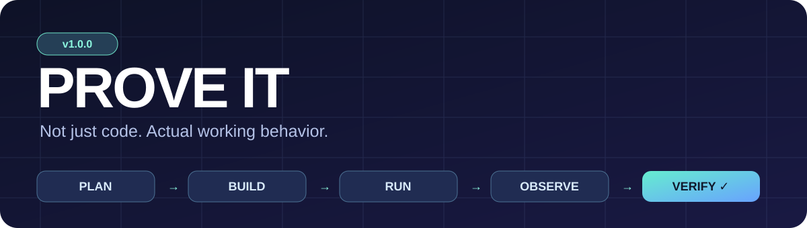
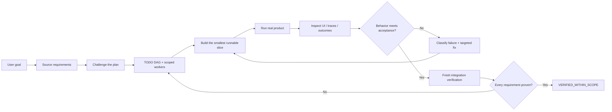
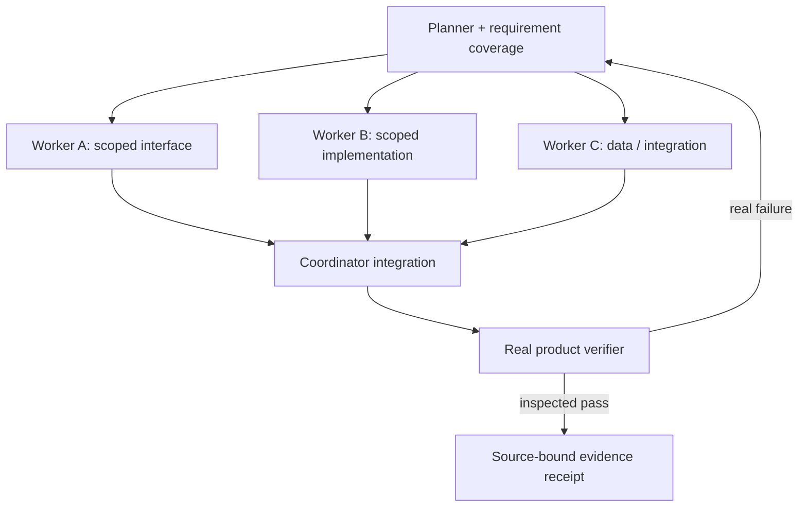

<div align="center">



# Prove It v1

**A tool-first, evidence-first skill for autonomous coding agents.**

[](CHANGELOG.md)
[](https://agentskills.io)
[](scripts/proof.py)
[](LICENSE)

**Plan the work. Run the product. Inspect the result. Prove it works.**

[Quick install](#-install) · [How it works](#-the-verification-loop) · [Use cases](#-what-it-checks) · [Safety](#-important-limitations) · [Versions](CHANGELOG.md)

</div>

---

## ⚡ Install

> **Install URL:** When this folder is published, use the GitHub directory URL to this `SKILL.md` folder. The portable Agent Skills CLI supports GitHub URLs and lets you choose a supported target agent. Installing the skill is **not** the same as enabling project-level stop hooks.

```bash
# Install in the current project from your published public GitHub skill URL
npx skills add https://github.com/abdoabozena7/mini_hivo/tree/main/skills/prove-it --skill prove-it

# Or, to choose from all supported coding-agent integrations
npx skills add https://github.com/abdoabozena7/mini_hivo/tree/main/skills/prove-it

# Verify what was installed
npx skills list
```

Requires Node.js 22.20+ for the current skills CLI. Check `npx skills --help` for supported agents and unattended options. To install globally, pass `-g` and explicitly choose the supported agent if needed. If this repo path is not published yet, use the local ZIP or path instead:

```bash
npx skills add ./prove-it-v1
```

### Dedicated optional enforcement harness

The portable `SKILL.md` works as instructions. To enable deterministic local evidence receipts and optional stop hooks, review the included Python tools, then run the installer's dry-run first:

```powershell
# From the unzipped skill folder:
py -3 .\scripts\install.py --agent copilot --scope user --project C:\path\to\your\repo --instructions --hooks --dry-run
py -3 .\scripts\install.py --agent copilot --scope user --project C:\path\to\your\repo --instructions --hooks
```

`--agent codex`, `--agent claude`, or `--agent generic` are supported for instructions/install; hooks only for Copilot and Claude where supported. The installer preserves existing instructions and backs up modified files; validate host-specific hook support in your actual client. Read [security boundaries](SECURITY.md) first.

## 🔄 The verification loop



A green unit-test suite, a passing commit, a worker saying “done”, or a screenshot file no one inspected **does not** prove the user's requested outcome.

## 🧠 Hivo-inspired, but agent-agnostic

| Mechanism | What it prevents | Output |
|:--|:--|:--|
| **Requirement ledger** | User goals disappearing during decomposition | Stable `REQ-*` IDs + original-source provenance |
| **Impact challenger** | Perfectly executed but incomplete plans | Reviewed change/preserve/test ownership |
| **Context sufficiency** | Workers guessing APIs and editing wrong files | Targeted repository facts before mutation |
| **Adaptive task DAG** | Monolithic prompts and pointless agent proliferation | Serial / hybrid / real subagent missions |
| **Failure taxonomy** | Repeated ineffective attempts | Falsifiable next experiments |
| **Verified memory** | Outdated "it worked" claims crossing revisions | Durable constraints vs source-bound facts |
| **Runtime acceptance** | Unit-test theater and mocked success | Inspected browser/simulator/CLI behavior |

The architecture is inspired by techniques explored in [Mini Hivo](https://github.com/abdoabozena7/mini_hivo); it does not import Mini Hivo's pinned model or claim its experimental results have universal validity. See [the detailed adaptation](references/hivo-patterns.md).

## 🧪 What it checks

| Project | Real interaction required | Proof to collect |
|:--|:--|:--|
| **Front-end / UI** | Start app; click buttons, type, resize, reload, test failures | Rendered screenshots + browser traces + state/network outcomes |
| **Back-end / API** | Call actual public API; verify persistence/error handling | Status/response/state changes and negative cases |
| **Simulation / CARLA** | Start authorized native engine, tick physics, observe ego/sensors and full required runs | Live run IDs, measured motion, video, collision/route metrics |
| **Mini Hivo / CLI agents** | Submit a real prompt through the actual CLI; execute generated artifact | Worker/tool trace + evaluated output behavior |
| **ML workflow** | Execute supported inference/training/validation path when authorized | Measured outputs; distinguish model, rendering, simulation and replay |



Subagents are **optional**. Use them only when your host actually supports delegation and tasks are independent. Otherwise execute the same DAG serially.

## ✅ Honest completion states

```text
TODO  →  IN_PROGRESS  →  IMPLEMENTED  →  VERIFIED
                  ↘ BLOCKED_UNVERIFIED ↗
```

`IMPLEMENTED` ≠ `VERIFIED`. A completed subagent ≠ completed user goal. Every verified item needs current-source evidence and an integrated user-journey check. The final report must say `VERIFIED_WITHIN_SCOPE`, `PARTIAL`, `FAILED`, or `BLOCKED_UNVERIFIED`.

## 🧰 What's in the box?

```text
prove-it/
├── SKILL.md                      # universal agent instructions
├── references/
│   ├── hivo-patterns.md          # better planning, recovery and memory
│   ├── planning-and-delegation.md
│   ├── acceptance-and-test-quality.md
│   ├── web-validation.md
│   ├── simulation-validation.md
│   └── cli-agent-validation.md
├── scripts/
│   ├── proof.py                  # local evidence receipts + gate
│   ├── planning.py               # DAG validation
│   ├── browser_probe.py          # optional real browser journey runner
│   └── install.py                # install, instructions, optional hooks
├── assets/templates/             # mission and evidence templates
├── tests/                        # harness regression tests
├── examples/                     # disposable demos
├── CHANGELOG.md                  # v1 → future updates
├── SECURITY.md
└── visual/banner.svg
```

## ▶️ A practical invocation

Use this in your coding agent after installation:

```text
Use prove-it for this task.
1. Capture the original user requirements and build a dependency-aware TODO plan.
2. Challenge omissions before touching implementation; select real subagents only if useful.
3. Execute the actual product in its real environment; collect and inspect evidence.
4. Classify failures; repair the smallest valid cause and rerun.
5. Integrate all branches/workers and verify the original journeys on final code.
6. Do not claim completion without current evidence and an honest final status.

Task: [your actual coding task]
```

For a source-bound local evidence contract, read [the harness guide](references/harness-guide.md) and call `python scripts/proof.py --help`. Optional browser probes use Playwright installed separately: `python -m pip install playwright && python -m playwright install chromium`.

## 🛡️ Important limitations

This is a **skill, not a universal agent runtime**. It cannot create browser access, GPU access, credentials, external service permissions, infinite background work, or unlimited budgets. It does not turn mocked data into native simulation evidence. The evidence gate checks declared contracts and current artifacts, **not mathematical correctness** of a self-authored oracle. A stop hook can request continuation but cannot defeat user stops or host execution limits.

Never bypass research holdout restrictions, experiment budgets, sandbox policies, protected files or safety controls to obtain a green result. Screenshots and traces can expose secrets; keep runtime evidence out of public Git commits. Full boundaries: [SECURITY.md](SECURITY.md) · [skill rules](SKILL.md).

## 🗓️ Versioning and updates

**v1.0.0** = first distributable public baseline. Future versions follow semantic versioning and should include a tested [CHANGELOG](CHANGELOG.md), a reproducible `skill.zip` and explicit limitations. Use `npx skills check` / `npx skills update` for supported installs; project-level hooks need separate review when version changes.

## 🤝 Contributions

Ideas and fixes are welcome: propose a real failure case and a measurable verification improvement. See [CONTRIBUTING.md](CONTRIBUTING.md). Licensed under [MIT](LICENSE).

<div align="center"><sub>Built for agents that demonstrate results instead of merely reporting progress.</sub></div>
